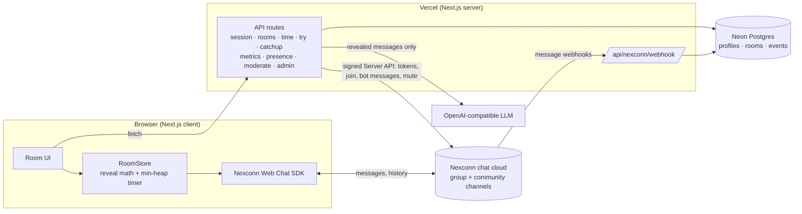

# SameBall architecture

## Stack
- **Next.js 16.4.5** (App Router, Cache Components), React 19.3, TypeScript strict, Tailwind 4. Deployed on Vercel (auto-deploys from `main`).
- **Nexconn Chat SDK 26.2.1** (`@nexconn/chat` in the browser) and the signed **Nexconn Server API** (`src/lib/nexconn-server.ts`).
- **Neon Postgres** via Drizzle (`src/lib/db/schema.ts`): profiles, rooms, room members, metric events, webhook message rows, feedback, reports. **Chat itself is never stored by us**; it lives in Nexconn.
- **AI**: any OpenAI-compatible API (Groq `gpt-oss-120b` in production) for "What did I miss?" only.
- Tests: Vitest (pure logic in `src/lib/timing`, `src/lib/*.test.ts`). CI: typecheck, lint, tests.

## Folder layout
```
src/app/            pages + API routes (/r/[code] room, /try, /stats, /privacy, /admin, /api/*)
src/components/     UI pieces (ChatTimeline, LockedBubble, Composer, CallIt, WaveSheet, ...)
src/lib/timing/     pure timing logic: reveal math, scheduler, clock, hype, wave, calibration, callit, sync solver
src/lib/transport/  Nexconn transport, local demo transport, wire format (zod)
src/lib/room/       useRoom: glues transport + RoomStore + React
src/lib/i18n/       en + hi dictionaries (typed: a missing Hindi key fails the build)
src/lib/            server helpers: nexconn-server, rooms, try (bots), admin, ai, catchup, webhook, auth, guard
```

## How a user connects
1. The browser calls `POST /api/session` with a name + emoji (and its saved `guestId` + `key` if any).
2. The server creates or reuses a guest id (`g_` + 20 chars; also the Nexconn user id), issues `key = HMAC(app secret, guestId)` (the guest's credential for our API), asks the Nexconn Server API for an **access token** (`/v4/auth/access-token/issue`) and joins the room's channel.
3. The browser loads the SDK with a dynamic import, `NCEngine.initialize` + `registerCustomMessages` + `NCEngine.connect({ token })` once per page lifetime.

No email, no phone. Bots (Judge Mode, host bot) are real Nexconn users flagged `is_bot`.

## Channel types
- **Rooms** = Nexconn **group channels** (`/v4/group-channel/create`, `/join`), up to 300 members; a full room overflows into "<name> · Stand B".
- **Stadiums** = Nexconn **community channels** (up to 10,000 members) with three public **sub-channels** as stands.
- We do **not** use chatrooms. Groups give us 180-day history (Ghost Crowd replays the next day) and membership (moderation, removal). Chatroom-only features such as chatroom KV attributes are therefore not available; shared state (presence) goes through our API.

## Messages
- Text: a normal `RC:TxtMsg`; its `extra` is JSON `{"sb":1,"lag":ms,"n":name,"a":avatar}`.
- Everything else is a registered custom type, JSON content that always carries `lag`: `SB:Roar`, `SB:Lag`, `SB:Anchor`, `SB:SyncCheck`, `SB:SyncTap`, `SB:Call`, `SB:CallVote`, `SB:CallResult` (`src/lib/transport/wire.ts`, zod-validated; malformed custom messages are dropped, malformed text shows unlocked).
- Sends go through `channel.sendMessage`, spaced 250 ms apart (client limit 5 msg/s). Receive: one `MessageHandler`, filtered by channel (and sub-channel for stadiums).
- History on (re)join: `BaseChannel.createMessagesQuery` (newest 300; 2,000 in replay). Every message goes through the same engine, so anything whose reveal time is still in the future for me comes back **locked**.

## Where the spoiler hold happens
**On the reader's device**, in `RoomStore` (`src/lib/timing/room-store.ts`) with the pure math in `engine.ts`:

```
matchTime = sentTime − senderLag      (sentTime = Nexconn's server time on the message)
revealAt  = matchTime + myLag         (my own messages and unstamped ones never lock)
```

A single min-heap scheduler (`scheduler.ts`) runs one timer for the next reveal. Locked messages are rendered as `LockedBubble`, which receives sender, avatar and countdown only, never the text (tested). The server never holds messages back: Nexconn delivers immediately, and the client decides when to show them. That keeps Nexconn as the only chat path and makes history and replays work the same way.

## Clock sync
`/api/time` returns server `Date.now()` (no cache). The client takes 5 NTP-style samples (`offset = ts − (t0+t1)/2`), uses the median, and refreshes every 5 minutes and after a reconnect (`clock.ts`). Message times come from Nexconn's server; both servers are NTP-synced (tens of ms).

## Judge Mode bots
`POST /api/try` creates a private group with two bot users. "Start the over" posts an `SB:Anchor` ("First ball") from a bot via the Server API. The visitor's browser then asks `POST /api/try/step` for each scripted step once its time arrives on the fastest feed; the server sends it as the bot (`/v4/group-channel/message/send`) exactly once (atomic bitmask in `rooms.try_steps`) and never early (425). Bots stamp lag 0.

## Metrics
- Client events are batched to `POST /api/metrics`; each row is flagged `is_test` if the profile is a test or bot user (`?test=1` marks a browser as a tester).
- Nexconn **webhooks** (`/api/nexconn/webhook`, signature + timestamp checked, deduped by message id) record every real message server-side. `/stats` prefers these counts.
- `/stats` excludes test and bot users everywhere; Judge Mode rooms are left out of the room count.

## Diagram


## Spoiler side channels
Anything that changes on screen because of a message can leak it early. Decisions:

| Channel | Decision |
|---|---|
| Message text | Never rendered while locked; `LockedBubble` gets no content. |
| Typing indicators | Not used (Nexconn typing status is never sent or shown). |
| Read receipts | Not used. |
| Presence / "watching now" | Count only, from our heartbeat; carries no message information. |
| Unread badges | Custom types are registered `isCounted: false`; we never show Nexconn unread counts. "My rooms" on the home page shows no previews or counts. |
| Tab title | Counts only: "(N locked)" / "(N new)". No text, no sender. |
| Notification previews | No push notifications today. Any future push must fire at the reader's `revealAt` with a content-free preview. |
| Link previews | Not generated. Links render as plain text, and only once revealed. |
| Reactions / Hype Radar | Hype gets numbers only (heat, seconds until the next reveal), never content or which chip. |
| Call it | The question, others' picks, the answer and points show only once revealed for me. |
| The Wave, AI catch-up, auto-sync | Built only from messages already revealed for me; the catch-up server re-checks `matchTime + myLag <= now`. An auto-sync suggestion can't appear before the reaction it's based on reached my screen. |
| Lag Leaderboard / member list | Uses the delay stamp on any message, locked ones included. It shows a delay number only, never content, sender timing or which moment. |
| "I paused" | While paused my delay grows second by second, so nothing unlocks; "I'm back" keeps the extra delay. |
| Match over / recap | The end-of-match marker is an anchor: each viewer's recap offer appears only once the end reaches their screen. The recap page and images show counts and names only. |
| Call it picker count | Counts only picks already revealed for me (plus mine). |
| Screen readers | `aria-live` announces revealed messages only. |
| OG / share images | Never include messages. |
| Vibration | Hype vibration says "something is coming", same as the strip. |

## Nexconn design decisions
- **One `SameBall:Moment` custom type?** Not adopted. Every message already carries the same fields: text uses `RC:TxtMsg` with `extra = {sb, lag, n, a}`, and each structured kind has its own registered `SB:*` type with `lag`. Nexconn gives us `sentTime`, so `revealAt = sentTime − senderLag + readerLag` is computed exactly as the brief describes. Switching would orphan existing history (Ghost Crowd replays read it for 180 days) and gain nothing.
- **Chatroom KV attributes:** not available, because rooms are group channels (180-day history, membership, moderation). Shared state that needs no history (presence) goes through `/api/presence`; shared match state (anchors, Call it, Sync Check) travels as custom messages, so it persists in history and replays.
- **History on rejoin:** done since P1 (`createMessagesQuery`); anything still ahead of the reader comes back locked.
- **Moderation:** creator mute (Server API mute list) and remove (leave) exist. The Web SDK also offers `deleteMessageForAll` (recall) and an `onMessageDeleted` handler; recall and mute-all are planned with creator rooms (Phase 3).

## Analytics events
Client events go to `POST /api/metrics`; every row is flagged `is_test` when the user is a test or bot profile (bots never send client events). Names used for the brief's list:

| Brief | Event |
|---|---|
| room_created | `room_created` |
| member_joined | `joined` |
| message_sent | `message_sent` (plus Nexconn webhook rows in `nc_messages`) |
| message_held | `message_locked` |
| message_revealed | `revealed_on_time` (and `spoil_me` when revealed early by choice) |
| poll_answered | `call_picked` (`call_started` for new polls) |
| recap_shared | `recap_shared` (`via`: whatsapp / story / copy), `recap_opened` (`from`: room / link) |
| invite_opened | `invite_opened` (joined through a `?ref=` invite link) |
| autosync_applied | `autosync_applied` (`deltaS`, `drift`) |
| — | `paused`, `lag_set`, `survey`, `feedback`, `wave_shared`, `catchup_used`, `replay_started`, `sync_check_done` |

The end-of-match survey (spoiled? would use again? comment) is stored in `feedback` (`spoiled`, `again` columns, migration 0005) and exported with `GET /api/admin/export?type=survey`.

## Known blockers and limits (Nov 6)
- **Nexconn dev app cap:** a development-mode app allows 100 registered users (error 2007). Every guest, bot and second window counts. Switch the app to production in the Console before real matches, or traction stops at 100.
- **Chatroom KV**: not applicable (rooms are groups). Presence stays on `/api/presence`.
- **Call SDK (Huddle)**: needs a card on file for the free minutes. Waiting for the owner's go-ahead.
- **Live score data** needs a cricket data API key; only a mock provider can ship without one.
- **Voice notes** need blob storage (Vercel Blob); **Web Push** needs VAPID keys and a service worker (none today).
