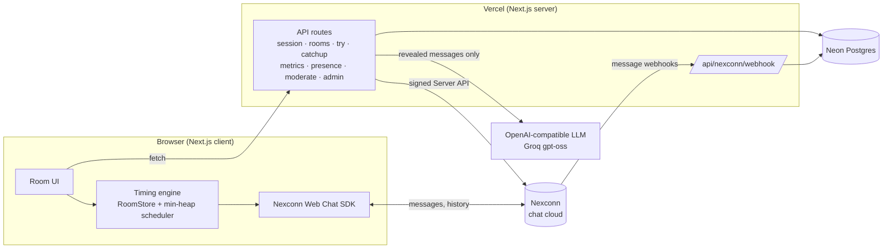

# SameBall

**The group chat that never spoils the match.**

Live: https://sameball.vercel.app · Try it alone in 30 seconds: https://sameball.vercel.app/try

## The problem

Friends watch the same match on different feeds. TV is a few seconds behind the stadium, DTH a bit more, a streaming app 20 to 40 seconds more. So the friend on the fastest feed types "SIX!!" and everyone else reads it before the ball is even bowled on their screen. Group chats made for live sport spoil the sport.

Every chat app races to deliver messages faster. SameBall delivers them **at the right moment**.

## What SameBall does

Each person sets how far behind their feed is (pick TV / DTH / streaming / radio / at the venue, then fine-tune). Every message carries the sender's lag. SameBall works out the match moment it refers to and holds it on each screen until that moment reaches that screen.

- **Locked bubbles.** Messages from friends ahead of you arrive locked with a countdown and unlock when your screen catches up. The locked bubble never contains the text, so nothing leaks to the page.
- **Hype Radar.** A heartbeat strip pulses when your squad is reacting to something you haven't seen yet: "👀 something's coming in 8s". No details, just the suspense.
- **Stadium Roar.** Hold 📣 to roar; the crowd sound plays on each phone at that phone's own moment.
- **Lag Leaderboard and Sync Check.** See who is "⚡ Live wire" and who is "🦕 30s in the past". Sync Check finds everyone's delay from one shared moment: everyone taps NOW when it hits their screen.
- **Call it.** A fair-play prediction game: someone asks "Next ball?", everyone picks 4 / 6 / OUT, and each person's picks close when the ball reaches *their* screen. The fast feed can't cheat, the slow feed can't be spoiled, and a points leaderboard runs all match.
- **Judge Mode (`/try`). A private room with two bot friends and a scripted final over, so you can see the magic alone, on one device, with no match on.
- **Ghost Crowd replay.** Watching a recording the next day? Sync to a moment, and the room's chat and roars replay alongside your video.
- **The Wave.** After a big moment, see it ripple across your squad's screens, then share it as a story image.
- **Crowd auto-calibration.** From when your friends reacted, SameBall suggests a better lag setting. It never changes your setting without asking.
- **"What did I miss?"** An AI summary built only from messages already revealed on your screen.
- **Big public stadiums.** Featured match rooms for up to 10,000 fans, split into North / South / East stands.
- **Hindi UI.** A one-tap हिंदी / English switch.
- **Safety and privacy.** Report, block, creator mute/remove, profanity filter, guest accounts with no email or phone, and a "Delete my data" button.

## Feature → how it uses Nexconn

| Feature | Nexconn |
|---|---|
| Rooms | **Group channels** (`/v4/group-channel/create`, `/join`), up to 300 members; overflow into a second "Stand B" room |
| Guest sign-in | **Server API** `/v4/auth/access-token/issue` mints a chat token per guest; **Web Chat SDK** `NCEngine.connect` |
| Spoiler-free chat | **Text messages** (`RC:TxtMsg`) with an `extra` field carrying the sender's lag, name and avatar; timing runs on the message's server `sentTime` |
| Roars, lag, sync check, schedule anchors, Call it | **Custom message types** registered with `registerCustomMessages`: `SB:Roar`, `SB:Lag`, `SB:SyncCheck`, `SB:SyncTap`, `SB:Anchor`, `SB:Call`, `SB:CallVote`, `SB:CallResult` |
| Late joiners, Ghost Crowd replay, catch-up | **Message history** (`BaseChannel.createMessagesQuery`); Ghost Crowd relies on Nexconn's 180-day group history |
| Judge Mode bots, anchors | **Server API** `/v4/group-channel/message/send` sends text and custom messages as bot users with the same metadata as real clients |
| Moderation | **Server API** `/v4/group-channel/user/mute-list/add` and `/v4/group-channel/leave` |
| Big public stadiums | **Community channels** (`/v4/community-channel/create`, `/join`, `/message/send`) with public **sub-channels** as stands; the SDK's `CommunitySubChannel` for sending and history |
| Reconnect banner | **Connection status handler** (`ConnectionStatusHandler`) |
| Live stats | **Webhooks** (message send events) counted on our server, signature-checked and deduplicated |

## Architecture



The timing rule: `matchTime = sentTime − senderLag`, and a message reveals on my screen at `matchTime + myLag`, using a clock offset measured against our server (median of 5 samples, refreshed every 5 minutes and after reconnect). One timer drives every reveal.

## Local setup

Requirements: Node 22+, a Nexconn app (App Key and Secret), a Neon Postgres database.

```bash
npm install
cp .env.example .env.local   # fill in the values below
npm run db:migrate
npm run dev
```

| Variable | What |
|---|---|
| `NEXCONN_APP_KEY`, `NEXCONN_APP_SECRET` | Nexconn Console → your app |
| `NEXCONN_API_BASE`, `NEXCONN_API_BASE_BACKUP`, `NEXCONN_AREA` | Server API domains and SDK area for your data center |
| `DATABASE_URL` | Neon pooled connection string |
| `ADMIN_TOKEN` | Protects `/admin` (feature rooms, post anchors, create stadiums) |
| `AI_BASE_URL`, `AI_API_KEY`, `AI_MODEL`, `AI_FALLBACK_MODEL` | Optional. Any OpenAI-compatible provider for "What did I miss?" (or `GEMINI_API_KEY`) |
| `NEXT_PUBLIC_FEATURE_*` | Set to `1` to turn on: `GHOST_CROWD`, `WAVE`, `AUTO_CALIBRATION`, `AI_CATCHUP`, `STADIUMS`, `HINDI`, `CALL_IT` |

Without Nexconn credentials you can still try the timing locally: open `/r/ANY?demo=1&lag=20` in two tabs (dev builds only; it uses a local BroadcastChannel, not Nexconn).

Checks: `npm run typecheck`, `npm run lint`, `npm test`, `npm run build`. CI runs the first three on every push.

## How judges can test it

**Alone, one device, no match on:** open https://sameball.vercel.app/try and tap **Start the demo**. You're on a slower feed than the two bot friends. Tap **Start the over** and watch their messages arrive locked and unlock as each ball reaches your screen. After the FOUR, Arjun asks "Ball 4?": pick before the ball reaches your screen and see if you called it. Tap ⏱ to change your feed and see the timing change. "Open a second window on the TV feed" shows the other side.

**Two devices:** create a room on the home page, open the invite link on the second device, and pick different feeds (for example TV on one, Streaming app on the other). Send "SIX!" from the faster one: the slower one shows a locked bubble with a countdown. Hold 📣 to roar.

**Replay (Ghost Crowd):** open a room with `?replay=1`, pick a moment and tap Sync when your video shows it.

## Prior work

Everything was built during the challenge, Nov 2026.
